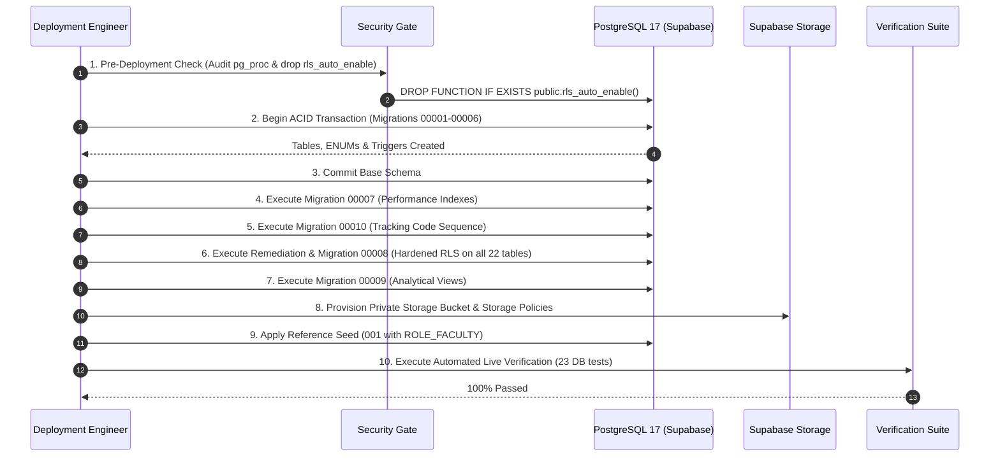

# Migration Deployment Readiness & Implementation Blueprint

**Project:** Campus Plus  
**Phase:** Phase 09A — Planning & Readiness Gate (DO NOT EXECUTE IN THIS PHASE)  
**Target Environment:** Supabase Cloud (`CampusPlus` / `gtwpxjpmwltxwjryazcu` / `ap-northeast-1`)  
**Database Engine:** PostgreSQL 17  
**Execution Standard:** Zero-Downtime, ACID-Bounded, Rollback-Ready  

---

## 1. Migration Deployment Readiness Classification

Each migration file in the repository has been evaluated for deployment safety:

| Migration File | Safe to Deploy As-Is? | Pre-Deployment Corrections Required |
| :--- | :---: | :--- |
| `00001_initial_types_and_extensions.sql` | **YES** | None. Safe for initial baseline. |
| `00002_core_institutional_tables.sql` | **YES** | None. Standard normalized DDL. |
| `00003_identity_and_access_tables.sql` | **YES** | Requires `ROLE_FACULTY` to be seeded in seed step. |
| `00004_complaint_aggregate_tables.sql` | **CONDITIONAL** | Needs closed-complaint immutability trigger (DEF-BIZ-002). |
| `00005_supporting_workflow_tables.sql` | **CONDITIONAL** | Needs 3-attachment count trigger (DEF-BIZ-003). |
| `00006_audit_and_outbox_tables.sql` | **CONDITIONAL** | Needs fixed `search_path` on trigger function (DEF-SEC-004). |
| `00007_indexes_and_performance.sql` | **YES** | None. Non-blocking index creation. |
| `00008_row_level_security_policies.sql` | **NO (BLOCKED)** | **CRITICAL DEFECT SEC-002:** Must add RLS on `users` table and remaining 15 tables before execution! |
| `00009_analytical_views.sql` | **YES** | None. Depends on tables in 00002 and 00004. |
| `00010_tracking_code_sequence.sql` | **YES** | None. Idempotent sequence creation. |

---

## 2. Proposed Phase 09B Deployment Sequence



---

## 3. Step-by-Step Execution Plan

### Step 1: Pre-Deployment Security Purge (Pre-Flight)
Before any repository DDL is executed on `gtwpxjpmwltxwjryazcu`:
1. Connect via direct administrative connection string.
2. Execute the security purge to eliminate the orphaned rogue function (SEC-001):
   ```sql
   REVOKE ALL ON FUNCTION public.rls_auto_enable() FROM PUBLIC, anon, authenticated;
   DROP FUNCTION IF EXISTS public.rls_auto_enable();
   ```
3. Verify that `_schema_migrations` does not exist or is clean.

### Step 2: DDL Phase 1 — Structural Foundation (`00001` to `00006`)
- **Transaction Boundary:** Wrapped in a single transactional block:
  ```sql
  BEGIN;
  -- \i migrations/00001_initial_types_and_extensions.sql
  -- \i migrations/00002_core_institutional_tables.sql
  -- \i migrations/00003_identity_and_access_tables.sql
  -- \i migrations/00004_complaint_aggregate_tables.sql
  -- \i migrations/00005_supporting_workflow_tables.sql
  -- \i migrations/00006_audit_and_outbox_tables.sql (with SEC-004 fix)
  COMMIT;
  ```
- **Failure Handling:** Any constraint error or syntax failure triggers automatic `ROLLBACK`, leaving zero orphan tables.

### Step 3: DDL Phase 2 — Indexes & Sequences (`00007`, `00010`)
- Execute `00007_indexes_and_performance.sql` (Creates 12 B-tree indexes).
- Execute `00010_tracking_code_sequence.sql` (Creates `tracking_code_seq`).

### Step 4: DDL Phase 3 — Hardened Security & RLS (`00008` Patched)
- **CRITICAL REQUIREMENT:** Migration `00008` must NOT be executed as currently written.
- The patched migration must include:
  1. `ALTER TABLE users ENABLE ROW LEVEL SECURITY; ALTER TABLE users FORCE ROW LEVEL SECURITY;`
  2. RLS policies on `users` protecting PII.
  3. `ENABLE` and `FORCE` RLS across all remaining 15 application tables.
  4. Execution privileges on `auth_has_role()` and `auth_user_department_id()` revoked from `PUBLIC`.

### Step 5: DDL Phase 4 — Analytical Views (`00009`)
- Execute `00009_analytical_views.sql`.

### Step 6: Supabase Storage Provisioning
- Execute storage DDL creating private bucket `campus-plus-attachments` with 5 MB limit and MIME whitelist.
- Apply storage RLS policies in `storage.objects` bound to grievance permissions.

### Step 7: Reference Seed Application (`001_reference_seed.sql` Patched)
- Apply master reference seed with `ROLE_FACULTY` included.

---

## 4. Post-Deployment Verification Checklist

1. **Table Count Audit:**
   ```sql
   SELECT count(*) FROM information_schema.tables 
   WHERE table_schema = 'public' AND table_type = 'BASE TABLE';
   -- Must equal exactly 22.
   ```
2. **RLS Activation Audit:**
   ```sql
   SELECT tablename FROM pg_tables 
   WHERE schemaname = 'public' AND rowsecurity = FALSE;
   -- Must return 0 rows. 100% of tables must have RLS active.
   ```
3. **Security Advisor Audit:**
   - Supabase Security Advisor must report 0 Critical and 0 High findings.
4. **Sequence Allocation Probe:**
   ```sql
   SELECT nextval('tracking_code_seq');
   -- Must return valid integer without error.
   ```
5. **PII PostgREST Probe:**
   - Execute unauthenticated `GET /rest/v1/users` with anon key and verify that response returns an empty array `[]` (zero leaked records).

---

## 5. Explicit Injunction

**DO NOT EXECUTE THIS DEPLOYMENT PLAN DURING PHASE 09A.**  
Phase 09A is exclusively dedicated to inspection, planning, and defect logging. Deployment is reserved for Phase 09B upon explicit authorization.
