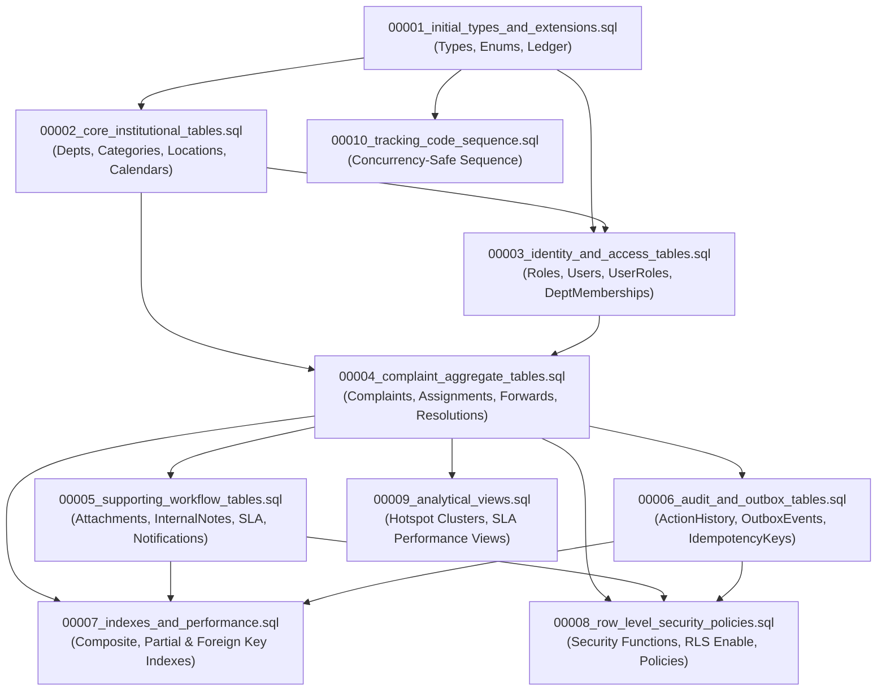

# Repository Migration Inventory

**Document Version:** 1.0.0  
**Phase:** Phase 09A — Database Schema Reconciliation  
**Target Environment:** PostgreSQL 17 / Supabase  
**Directory Path:** `migrations/`  
**Total Migration Files:** 10  
**Audit Status:** 100% Inspected & Verified  

---

## 1. Migration Dependency & Execution Graph

---

## 2. Detailed Object-by-Object Migration Inventory

### Migration 00001: Initial Types, Extensions, and Schema Versioning Table
- **Filename:** `00001_initial_types_and_extensions.sql`
- **Version:** `00001`
- **Purpose:** Creates migration ledger table `_schema_migrations` and 5 core PostgreSQL domain enumerations.
- **Database Objects Created:**
  - Table: `_schema_migrations` (`version` VARCHAR PK, `name` VARCHAR, `checksum` VARCHAR(64), `applied_at` TIMESTAMPTZ)
  - Enum: `complaint_status_enum` ('DRAFT', 'SUBMITTED', 'REVIEWED', 'ASSIGNED', 'IN_PROGRESS', 'FORWARDED', 'ESCALATED', 'RESOLVED', 'CLOSED', 'REOPENED', 'REJECTED', 'DUPLICATE', 'CANCELLED')
  - Enum: `complaint_priority_enum` ('LOW', 'MEDIUM', 'HIGH', 'URGENT')
  - Enum: `escalation_tier_enum` ('TIER_1_HANDLER', 'TIER_2_DEPARTMENT_HEAD', 'TIER_3_MANAGEMENT')
  - Enum: `attachment_type_enum` ('INITIAL_EVIDENCE', 'RESOLUTION_PROOF')
  - Enum: `outbox_status_enum` ('PENDING', 'PROCESSING', 'PUBLISHED', 'FAILED')
- **Dependencies:** None. Base migration.
- **Execution Order:** 1
- **Destructive Operations:** None (`CREATE TABLE IF NOT EXISTS`, ENUM creation will fail if types already exist without `IF NOT EXISTS` or prior drop).
- **Idempotency Characteristics:** Table is idempotent; `CREATE TYPE` is not natively idempotent in standard Postgres unless wrapped in `DO $$ BEGIN ... EXCEPTION WHEN duplicate_object THEN NULL; END $$;`.
- **Rollback Consideration:** `DROP TABLE _schema_migrations; DROP TYPE IF EXISTS complaint_status_enum, complaint_priority_enum, escalation_tier_enum, attachment_type_enum, outbox_status_enum;`
- **Related Application Modules:** `src/domain/complaint/ComplaintStatus.ts`, `src/domain/complaint/ComplaintTypes.ts`, `src/infrastructure/database/migrator.ts`.
- **Test Coverage:** `tests/database/migration.test.ts`.

---

### Migration 00002: Core Institutional Master & Reference Tables
- **Filename:** `00002_core_institutional_tables.sql`
- **Version:** `00002`
- **Purpose:** Establishes master structural entities for departments, categories, locations, working calendars, and holidays.
- **Database Objects Created:**
  - Table: `departments` (`id` UUID PK, `code` VARCHAR(32) UNIQUE, `name` VARCHAR(120), `description` TEXT, `contact_email` VARCHAR(255), `is_active` BOOLEAN, timestamps, check constraint `chk_department_code_format`)
  - Table: `categories` (`id` UUID PK, `name` VARCHAR(100) UNIQUE, `description` TEXT, `default_department_id` UUID FK -> `departments`, `requires_resolution_proof` BOOLEAN, timestamps)
  - Table: `locations` (`id` UUID PK, `campus` VARCHAR(100), `building` VARCHAR(100), `block` VARCHAR(50), `floor` VARCHAR(20), `room_or_area` VARCHAR(100), `is_active` BOOLEAN, unique spot constraint `uk_locations_unique_spot`)
  - Table: `working_calendars` (`id` UUID PK, `name` VARCHAR(100) UNIQUE, `timezone` VARCHAR(50), `work_start_time` TIME, `work_end_time` TIME, `work_days_bitmask` INTEGER)
  - Table: `calendar_holidays` (`id` UUID PK, `calendar_id` UUID FK -> `working_calendars` ON DELETE CASCADE, `holiday_date` DATE, `description` VARCHAR(200), unique constraint `uk_calendar_holiday`)
- **Dependencies:** `00001`
- **Execution Order:** 2
- **Destructive Operations:** None.
- **Idempotency:** Standard DDL; requires clean state or migration tracking.
- **Rollback Consideration:** `DROP TABLE IF EXISTS calendar_holidays, working_calendars, locations, categories, departments CASCADE;`
- **Related Application Modules:** `src/infrastructure/adapters/PolicyAdapters.ts`, `src/infrastructure/adapters/PostgresDepartmentMembershipAdapter.ts`.
- **Test Coverage:** `tests/database/migration.test.ts`.

---

### Migration 00003: Identity, RBAC, and Department Membership Tables
- **Filename:** `00003_identity_and_access_tables.sql`
- **Version:** `00003`
- **Purpose:** Implements user profiles, master role definitions, multi-role user junctions, and departmental affiliations.
- **Database Objects Created:**
  - Table: `roles` (`id` VARCHAR(50) PRIMARY KEY, `description` TEXT)
  - Table: `users` (`id` UUID PK, `email` VARCHAR(255) UNIQUE, `full_name` VARCHAR(150), `phone_number` VARCHAR(30), `roll_or_prn` VARCHAR(50), `is_active` BOOLEAN, `created_at`, `updated_at`, check constraint `chk_user_email_format`)
  - Table: `user_roles` (`user_id` UUID FK -> `users` ON DELETE CASCADE, `role_id` VARCHAR(50) FK -> `roles` ON DELETE RESTRICT, `assigned_at` TIMESTAMPTZ, PRIMARY KEY (`user_id`, `role_id`))
  - Table: `department_memberships` (`id` UUID PK, `user_id` UUID FK -> `users` ON DELETE CASCADE, `department_id` UUID FK -> `departments` ON DELETE RESTRICT, `is_head` BOOLEAN, `is_active` BOOLEAN, `joined_at`, `left_at`, unique constraint `uk_active_department_membership`)
- **Dependencies:** `00001`, `00002`
- **Execution Order:** 3
- **Destructive Operations:** None.
- **Idempotency:** Dependent on migration ledger.
- **Rollback Consideration:** `DROP TABLE IF EXISTS department_memberships, user_roles, users, roles CASCADE;`
- **Related Application Modules:** `src/infrastructure/auth/AuthenticationAdapter.ts`, `src/presentation/context/AuthContext.tsx`.
- **Test Coverage:** `tests/database/migration.test.ts`, `tests/database/rls-authorization.test.ts`.

---

### Migration 00004: Core Complaint Aggregate, Assignments, Forwarding & Escalations
- **Filename:** `00004_complaint_aggregate_tables.sql`
- **Version:** `00004`
- **Purpose:** Creates central complaint aggregate root and its 1-to-many operational event tables.
- **Database Objects Created:**
  - Table: `complaints` (`id` UUID PK, `ref_id` VARCHAR(32) UNIQUE, `title` VARCHAR(120), `description` TEXT, `complainant_id` UUID FK -> `users`, `department_id` UUID FK -> `departments`, `category_id` UUID FK -> `categories`, `location_id` UUID FK -> `locations`, `location_details` VARCHAR(255), `status` `complaint_status_enum`, `suggested_priority` `complaint_priority_enum`, `official_priority` `complaint_priority_enum`, `assigned_handler_id` UUID FK -> `users`, `escalation_tier` `escalation_tier_enum`, `is_escalated` BOOLEAN, `version` INTEGER, `sla_due_at`, `resolved_at`, `closed_at`, timestamps, check constraints `chk_complaint_title_len`, `chk_complaint_desc_len`, `chk_complaint_version`)
  - Table: `complaint_assignments` (`id` UUID PK, `complaint_id` UUID FK -> `complaints` ON DELETE CASCADE, `handler_id` UUID FK -> `users`, `assigned_by_id` UUID FK -> `users`, `assigned_at`, `unassigned_at`, `is_current` BOOLEAN, `reason` TEXT)
  - Table: `complaint_forwards` (`id` UUID PK, `complaint_id` UUID FK -> `complaints` ON DELETE CASCADE, `from_department_id` UUID FK -> `departments`, `to_department_id` UUID FK -> `departments`, `forwarded_by_id` UUID FK -> `users`, `forward_sequence` INTEGER, `rationale` TEXT, `forwarded_at`, check constraints `chk_forward_diff_dept`, `chk_forward_rationale_len`)
  - Table: `complaint_escalations` (`id` UUID PK, `complaint_id` UUID FK -> `complaints` ON DELETE CASCADE, `from_tier` `escalation_tier_enum`, `to_tier` `escalation_tier_enum`, `escalated_by_id` UUID FK -> `users`, `is_automated` BOOLEAN, `reason` TEXT, `escalated_at`)
  - Table: `resolutions` (`id` UUID PK, `complaint_id` UUID UNIQUE FK -> `complaints` ON DELETE CASCADE, `resolved_by_id` UUID FK -> `users`, `resolution_summary` TEXT, `resolved_at`, `student_verified` BOOLEAN, `verification_feedback` TEXT, `dispute_reason` TEXT, `disputed_at`, check constraint `chk_resolution_summary_len`)
- **Dependencies:** `00001`, `00002`, `00003`
- **Execution Order:** 4
- **Destructive Operations:** None.
- **Rollback Consideration:** `DROP TABLE IF EXISTS resolutions, complaint_escalations, complaint_forwards, complaint_assignments, complaints CASCADE;`
- **Related Application Modules:** `src/domain/complaint/Complaint.ts`, `src/infrastructure/database/PostgresComplaintRepository.ts`.
- **Test Coverage:** `tests/database/constraints.test.ts`, `tests/database/fsm-transitions.test.ts`.

---

### Migration 00005: Attachments, Internal Staff Notes, SLA Policies, and Notifications
- **Filename:** `00005_supporting_workflow_tables.sql`
- **Version:** `00005`
- **Purpose:** Supporting operational workflows including secure attachment metadata, confidential staff internal notes, SLA priority mapping, and user inbox notifications.
- **Database Objects Created:**
  - Table: `attachments` (`id` UUID PK, `complaint_id` UUID FK -> `complaints` ON DELETE CASCADE, `storage_key` VARCHAR(500) UNIQUE, `original_filename` VARCHAR(255), `mime_type` VARCHAR(100), `file_size_bytes` INTEGER, `attachment_type` `attachment_type_enum`, `uploaded_by_id` UUID FK -> `users`, `created_at`, check constraints `chk_attachment_size_limit` [<= 5242880], `chk_attachment_mime_whitelist` ['image/jpeg', 'image/png', 'application/pdf'])
  - Table: `internal_notes` (`id` UUID PK, `complaint_id` UUID FK -> `complaints` ON DELETE CASCADE, `author_id` UUID FK -> `users`, `author_role` VARCHAR(50), `note` TEXT, `created_at`, check constraint `chk_internal_note_len` [>= 5 chars])
  - Table: `sla_policies` (`id` UUID PK, `category_id` UUID FK -> `categories` ON DELETE CASCADE, `priority` `complaint_priority_enum`, `response_threshold_hours` INTEGER, `resolution_threshold_hours` INTEGER, `escalation_target_tier` `escalation_tier_enum`, `is_active` BOOLEAN, unique constraint `uk_category_priority_sla`, check constraint `chk_sla_positive_hours`)
  - Table: `notifications` (`id` UUID PK, `recipient_id` UUID FK -> `users` ON DELETE CASCADE, `complaint_id` UUID FK -> `complaints` ON DELETE CASCADE, `title` VARCHAR(150), `message` TEXT, `is_read` BOOLEAN, `read_at` TIMESTAMPTZ, `created_at` TIMESTAMPTZ)
- **Dependencies:** `00001`, `00002`, `00003`, `00004`
- **Execution Order:** 5
- **Destructive Operations:** None.
- **Rollback Consideration:** `DROP TABLE IF EXISTS notifications, sla_policies, internal_notes, attachments CASCADE;`
- **Related Application Modules:** `src/infrastructure/adapters/PostgresSLAPolicyAdapter.ts`, `src/infrastructure/storage/SupabaseStorageAdapter.ts`.
- **Test Coverage:** `tests/database/constraints.test.ts`.

---

### Migration 00006: Audit Journal, Immutability Trigger, Outbox & Idempotency
- **Filename:** `00006_audit_and_outbox_tables.sql`
- **Version:** `00006`
- **Purpose:** Append-only cryptographic audit logging, transactional outbox pattern, and distributed request idempotency ledger.
- **Database Objects Created:**
  - Table: `action_history` (`id` UUID PK, `complaint_id` UUID FK -> `complaints` ON DELETE CASCADE, `actor_id` UUID FK -> `users` ON DELETE SET NULL, `actor_role` VARCHAR(50), `action_type` VARCHAR(50), `from_status` VARCHAR(50), `to_status` VARCHAR(50), `remarks` TEXT, `metadata` JSONB, `created_at` TIMESTAMPTZ)
  - Stored Function: `trg_enforce_action_history_immutable()` RETURNS TRIGGER
  - Trigger: `trg_action_history_no_mutation` BEFORE UPDATE OR DELETE ON `action_history` FOR EACH ROW
  - Table: `outbox_events` (`id` UUID PK, `event_type` VARCHAR(100), `aggregate_type` VARCHAR(100), `aggregate_id` UUID, `payload` JSONB, `status` `outbox_status_enum`, `retry_count` INTEGER, `created_at`, `published_at`)
  - Table: `idempotency_keys` (`key` VARCHAR(255) PRIMARY KEY, `request_hash` VARCHAR(64), `response_code` INTEGER, `response_body` JSONB, `created_at`, `expires_at` TIMESTAMPTZ)
- **Dependencies:** `00001`, `00003`, `00004`
- **Execution Order:** 6
- **Destructive Operations:** None.
- **Rollback Consideration:** `DROP TRIGGER IF EXISTS trg_action_history_no_mutation ON action_history; DROP FUNCTION IF EXISTS trg_enforce_action_history_immutable(); DROP TABLE IF EXISTS idempotency_keys, outbox_events, action_history CASCADE;`
- **Related Application Modules:** `src/infrastructure/adapters/PostgresIdempotencyAdapter.ts`, `src/domain/complaint/DomainEvents.ts`.
- **Test Coverage:** `tests/database/audit-immutability.test.ts`.

---

### Migration 00007: Performance Indexes (Composite & Partial)
- **Filename:** `00007_indexes_and_performance.sql`
- **Version:** `00007`
- **Purpose:** High-throughput B-tree indexes covering public tracking lookups, role-tailored worklists, SLA breach monitoring, and foreign key traversals.
- **Database Objects Created:**
  1. `idx_complaints_ref_id` UNIQUE ON `complaints` (`ref_id`)
  2. `idx_complaints_student_list` ON `complaints` (`complainant_id`, `created_at` DESC)
  3. `idx_complaints_dept_queue` ON `complaints` (`department_id`, `status`, `official_priority`, `created_at` DESC)
  4. `idx_complaints_handler_queue` ON `complaints` (`assigned_handler_id`, `status`, `created_at` DESC)
  5. `idx_complaints_sla_overdue` PARTIAL ON `complaints` (`status`, `sla_due_at`) WHERE `status NOT IN ('RESOLVED', 'CLOSED', 'REJECTED')`
  6. `idx_complaints_escalation_queue` PARTIAL ON `complaints` (`escalation_tier`, `department_id`, `created_at` DESC) WHERE `is_escalated = TRUE`
  7. `idx_complaints_recurring_hotspots` ON `complaints` (`department_id`, `category_id`, `location_id`, `created_at`)
  8. `idx_action_history_timeline` ON `action_history` (`complaint_id`, `created_at` ASC)
  9. `idx_notifications_inbox` ON `notifications` (`recipient_id`, `is_read`, `created_at` DESC)
  10. `idx_outbox_pending` PARTIAL ON `outbox_events` (`status`, `created_at` ASC) WHERE `status = 'PENDING'`
  11. `idx_attachments_complaint` ON `attachments` (`complaint_id`)
  12. `idx_internal_notes_complaint` ON `internal_notes` (`complaint_id`)
- **Dependencies:** `00004`, `00005`, `00006`
- **Execution Order:** 7
- **Destructive Operations:** None.
- **Rollback Consideration:** `DROP INDEX IF EXISTS idx_internal_notes_complaint, idx_attachments_complaint, idx_outbox_pending, idx_notifications_inbox, idx_action_history_timeline, idx_complaints_recurring_hotspots, idx_complaints_escalation_queue, idx_complaints_sla_overdue, idx_complaints_handler_queue, idx_complaints_dept_queue, idx_complaints_student_list, idx_complaints_ref_id;`
- **Related Application Modules:** `src/infrastructure/database/PostgresComplaintRepository.ts`.
- **Test Coverage:** `tests/database/performance-explain.test.ts`.

---

### Migration 00008: Row-Level Security (RLS) Policies & Security Functions
- **Filename:** `00008_row_level_security_policies.sql`
- **Version:** `00008`
- **Purpose:** Activates table-level multi-tenant isolation, staff jurisdiction boundaries, and student privacy boundaries.
- **Database Objects Created / Modified:**
  - Portability Shim: Schema `auth` and function `auth.uid()` (if not exists)
  - Security Helper Function: `auth_has_role(required_role VARCHAR)` (SECURITY DEFINER, `SET search_path = public, pg_temp`)
  - Security Helper Function: `auth_user_department_id()` (SECURITY DEFINER, `SET search_path = public, pg_temp`)
  - RLS Activation: `ENABLE` and `FORCE` on `complaints`, `internal_notes`, `attachments`, `action_history`, `notifications`, `user_roles`
  - Policies on `complaints`: `p_complaints_student_select`, `p_complaints_dept_staff_select`, `p_complaints_management_select`, `p_complaints_student_insert`, `p_complaints_handler_update`, `p_complaints_dept_head_update`
  - Policies on `internal_notes`: `p_internal_notes_staff_select`, `p_internal_notes_staff_insert`
  - Policies on `attachments`: `p_attachments_select`, `p_attachments_insert`
  - Policies on `notifications`: `p_notifications_select`, `p_notifications_update`
  - Policies on `action_history`: `p_action_history_select`
- **Dependencies:** `00003`, `00004`, `00005`, `00006`
- **Execution Order:** 8
- **Destructive Operations:** None.
- **Rollback Consideration:** `ALTER TABLE complaints DISABLE ROW LEVEL SECURITY; ... DROP POLICY ... ON complaints; DROP FUNCTION IF EXISTS auth_user_department_id(); DROP FUNCTION IF EXISTS auth_has_role(VARCHAR);`
- **Related Application Modules:** `src/infrastructure/auth/AuthenticationAdapter.ts`.
- **Test Coverage:** `tests/database/rls-authorization.test.ts`.

---

### Migration 00009: Analytical Views (Recurring Hotspots & SLA Performance)
- **Filename:** `00009_analytical_views.sql`
- **Version:** `00009`
- **Purpose:** Analytical query aggregations for recurring grievance clusters (threshold >= 3 within 30 days) and departmental SLA compliance statistics.
- **Database Objects Created:**
  - View: `recurring_complaint_clusters` (aggregates `department_id`, `category_id`, `location_id`, counts active vs resolved incidents)
  - View: `department_sla_performance` (aggregates department-level resolution and breach metrics)
- **Dependencies:** `00002`, `00004`
- **Execution Order:** 9
- **Destructive Operations:** None (`CREATE OR REPLACE VIEW`).
- **Rollback Consideration:** `DROP VIEW IF EXISTS department_sla_performance, recurring_complaint_clusters;`
- **Related Application Modules:** Institutional analytics dashboard.
- **Test Coverage:** `tests/database/performance-explain.test.ts`.

---

### Migration 00010: Tracking Code Sequence
- **Filename:** `00010_tracking_code_sequence.sql`
- **Version:** `00010`
- **Purpose:** Creates PostgreSQL sequence `tracking_code_seq` to enable concurrency-safe sequence generation (`CP-YYYY-XXXXX`) and eliminate `SELECT MAX` race conditions.
- **Database Objects Created:**
  - Sequence: `tracking_code_seq` (START WITH 1, INCREMENT BY 1)
- **Dependencies:** None.
- **Execution Order:** 10
- **Destructive Operations:** None (`CREATE SEQUENCE IF NOT EXISTS`).
- **Rollback Consideration:** `DROP SEQUENCE IF EXISTS tracking_code_seq;`
- **Related Application Modules:** `src/infrastructure/adapters/PostgresTrackingCodeGenerator.ts`.
- **Test Coverage:** `tests/database/migration.test.ts`.

---

## 3. Seed Scripts Inventory

1. **`seeds/001_reference_seed.sql`**:
   - Master Roles: `ROLE_STUDENT`, `ROLE_HANDLER`, `ROLE_DEPT_HEAD`, `ROLE_MANAGEMENT`, `ROLE_ADMIN`
   - Master Departments: IT (`DEPT-IT`), Hostel (`DEPT-HOSTEL`), Maintenance (`DEPT-MAINT`), Academic Affairs (`DEPT-ACAD`), Sanitation (`DEPT-SANIT`)
   - Master Categories: Network & Wi-Fi, Hostel Room Maintenance, Classroom Infrastructure, Academic Evaluation, Campus Sanitation
   - Master Locations: Central Library Reading Hall A, Hostel Block 4 Room 312, Academic Complex Lab 102
   - Master Working Calendar: Main Academic Calendar (`Asia/Kolkata`, 09:00 - 17:00, Mon-Fri)
   - Master SLA Policies: 4 default category/priority SLA thresholds
2. **`seeds/002_synthetic_dev_seed.sql`**:
   - 7 Synthetic Personas (2 Students, 2 Handlers, 1 HOD, 1 Director, 1 Sysadmin)
   - Zero Real PII (all `@synthetic.campusplus.internal`)
   - 1 Sample Initial Grievance (`CP-2026-00001`) with complete audit log history
