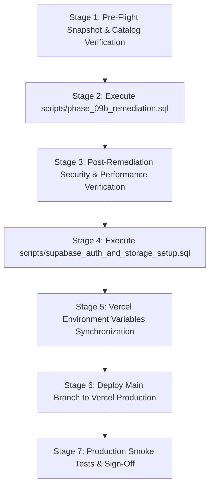

# 10 — Safe Production Deployment Plan (Phase 09B-2 & 09B-3 Runbook)

**Project:** Campus Plus — Campus Complaint & Grievance Resolution System  
**Target Infrastructure:** Supabase Managed PostgreSQL 17 (`gtwpxjpmwltxwjryazcu` / `ap-northeast-1`)  
**Deployment Classification:** CONTROLLED ZERO-DOWNTIME DATABASE & INFRASTRUCTURE ROLLOUT  
**Target Window:** Scheduled Maintenance Window (Zero Production Traffic)  

---

## 1. Non-Negotiable Deployment Invariants

1. **Absolute Preservation:** The existing live database, records, tables, and sequence must be preserved. No `DROP TABLE`, `TRUNCATE`, or `supabase db reset` may be executed.
2. **Transaction Bounded:** All database DDL and DML operations must execute within an explicit `BEGIN; ... COMMIT;` transaction block.
3. **Backup Before Touch:** A full schema and data snapshot must be verified before executing any DDL.
4. **Idempotency:** Every script must be safe to execute multiple times without error or duplicate data creation.
5. **Phase Boundaries:** Phase 09B-1 is strictly reconciliation and planning. Live execution occurs exclusively in Phase 09B-2 (Database Remediation) and Phase 09B-3 (Storage & Auth Deployment).

---

## 2. Step-by-Step Deployment Runbook



---

### Stage 1: Pre-Flight Backup & Catalog Verification
1. **Supabase Cloud Snapshot:**
   - Navigate to Supabase Dashboard -> Project `gtwpxjpmwltxwjryazcu` -> Database -> Backups.
   - Trigger a manual Point-In-Time (PITR) backup snapshot.
2. **Catalog Baseline Verification Query:**
   ```sql
   SELECT 
       (SELECT count(*) FROM information_schema.tables WHERE table_schema = 'public') as table_count,
       (SELECT count(*) FROM pg_policies WHERE schemaname = 'public') as policy_count,
       (SELECT count(*) FROM roles) as role_count;
   ```
   - **Expected Baseline:** `table_count = 22`, `policy_count = 25`, `role_count = 6`.

---

### Stage 2: Controlled Remediation Script Execution
1. **Target Script:** `scripts/phase_09b_remediation.sql`.
2. **Execution Method:** Supabase Dashboard SQL Editor (or direct `psql` via connection string):
   ```bash
   psql "$DATABASE_URL" -f scripts/phase_09b_remediation.sql
   ```
3. **Operations Executed Atomically:**
   - Purge rogue function `public.rls_auto_enable()`.
   - Update `auth_has_role()` and `auth_user_department_id()` with strict search paths and least-privilege grants (`REVOKE FROM PUBLIC, anon; GRANT TO authenticated`).
   - Recreate `recurring_complaint_clusters` and `department_sla_performance` with `WITH (security_invoker = true)`.
   - Enable and force RLS on `complaint_assignments`, `complaint_forwards`, and `complaint_escalations` with staff read policies.
   - Create 19 foreign key covering indexes (`PERF-001`).
   - Idempotently seed `ROLE_FACULTY` into `roles` table.

---

### Stage 3: Post-Remediation Verification Gate
Run verification queries in SQL Editor:
```sql
-- 1. Verify rogue function dropped
SELECT count(*) FROM pg_proc WHERE proname = 'rls_auto_enable';
-- Must return 0.

-- 2. Verify view security invoker status
SELECT relname, reloptions FROM pg_class 
WHERE relname IN ('recurring_complaint_clusters', 'department_sla_performance');
-- Must show security_invoker=true.

-- 3. Verify foreign key covering indexes
SELECT count(*) FROM pg_indexes 
WHERE indexname LIKE 'idx_complaint_%' OR indexname LIKE 'idx_resolutions_%';
-- Must be greater than or equal to 19.

-- 4. Verify system roles
SELECT id FROM roles ORDER BY id;
-- Must list: ROLE_ADMIN, ROLE_DEPT_HEAD, ROLE_FACULTY, ROLE_HANDLER, ROLE_MANAGEMENT, ROLE_STUDENT.
```

---

### Stage 4: Storage & Auth User Sync Deployment (Phase 09B-3)
1. **Target Script:** `scripts/supabase_auth_and_storage_setup.sql`.
2. **Execution Method:** Supabase Dashboard SQL Editor.
3. **Operations Executed:**
   - Create private bucket `campus-plus-attachments` with 5 MB limit and MIME whitelist (`image/jpeg`, `image/png`, `application/pdf`).
   - Apply storage RLS policies on `storage.objects` (`p_storage_complaint_attachments_select` and `p_storage_complaint_attachments_insert`).
   - Create trigger `on_auth_user_created` on `auth.users` to sync new accounts to `public.users` with default `ROLE_STUDENT`.

---

### Stage 5: Vercel Environment Configuration
1. Update Vercel Project Settings with required production secrets (refer to `PRODUCTION_ENVIRONMENT_AUDIT.md` Section 4).
2. Ensure `DATABASE_URL` uses the Supavisor connection pooler URI (`aws-0-ap-northeast-1.pooler.supabase.com:6543`).
3. Ensure `APP_SECRET` and `CRON_SECRET` meet minimum entropy and character length thresholds.

---

### Stage 6: Application Deployment
1. Trigger Vercel production deployment from `main` branch.
2. Confirm build logs indicate Turbopack compilation with 12 static pages and 19 dynamic API routes.

---

### Stage 7: Production Smoke Tests
1. **Health Check:** `GET /api/health` -> HTTP 200 `{ status: "ok" }`.
2. **Public Landing:** `GET /` -> HTTP 200 (Institutional branding renders).
3. **Student Login & Actor Resolution:** Sign in via `student.a@synthetic.campusplus.internal` -> `GET /api/v1/auth/me` returns `ROLE_STUDENT`.
4. **Complaint Workflows:** View active complaints; verify RLS enforces student data isolation.
