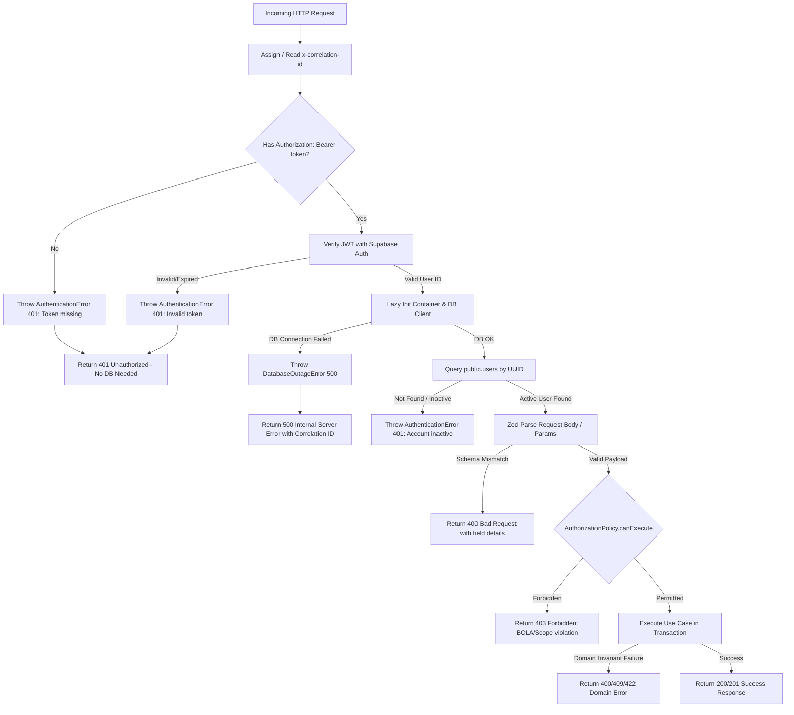

# Phase 09B — API Request Lifecycle & Error Handling Architecture

**Classification:** API Security & Error Architecture  
**Target:** Next.js App Router API Routes (`/api/v1/*`)  
**Components:** `src/presentation/utils/errorHandler.ts`, `src/infrastructure/auth/AuthenticationAdapter.ts`  

---

## 1. Secure API Request Lifecycle



---

## 2. Standardized Error Response Envelope

Every error response returned by Campus Plus conforms strictly to the `ApiErrorEnvelope` specification:

```typescript
export interface ApiErrorEnvelope {
  success: false;
  error: {
    code: string;           // Machine-readable uppercase token (e.g. UNAUTHENTICATED, FORBIDDEN)
    message: string;        // Human-readable diagnostic message (scrubbed of internal secrets)
    correlation_id: string; // Unique UUID tracing request across client, API, and logger
    details?: unknown;      // Structured validation issues or contextual debugging metadata
  };
}
```

### HTTP Status Code Taxonomy

| HTTP Status | Error Code | Trigger Condition |
| :--- | :--- | :--- |
| **`400 Bad Request`** | `VALIDATION_FAILED` | Zod schema parsing failure, malformed UUID, illegal parameter. |
| **`401 Unauthorized`** | `UNAUTHENTICATED` | Missing bearer token, expired JWT, tampered signature, deactivated account. |
| **`403 Forbidden`** | `FORBIDDEN` | Student attempting staff action, cross-department handler access, BOLA violation. |
| **`404 Not Found`** | `NOT_FOUND` | Complaint, attachment, or timeline event does not exist in directory. |
| **`409 Conflict`** | `CONFLICT` | Optimistic Concurrency Control (OCC) version collision, duplicate PRN, duplicate submission. |
| **`500 Internal Error`**| `INTERNAL_ERROR` | Database connectivity failure, Supabase service outage, unhandled system exception. |

---

## 3. Fast-Fail Authentication vs Genuine Infrastructure Failure

### 3.1 The Fast-Fail Rule
- **Rule:** If a request arrives without credentials (`authorization` header is absent or whitespace), the API route MUST reject it with `401 Unauthorized` **immediately** without initializing the database connection pool or contacting Supabase.
- **Benefits:**
  - Zero database connection checkout for unauthenticated requests.
  - Immune to database pool exhaustion attacks from internet scanners.
  - Sub-millisecond response latency.

### 3.2 Distinguishing Database Outages from Auth Failures
- **Anti-Pattern:** Catching all errors and masking them as 401 or masking 401 as 500.
- **Strict Separation:**
  1. If the client provides a valid JWT, but PostgreSQL is down when querying `public.users`, the error is a **genuine infrastructure failure**. The API must return **`500 Internal Server Error`** (with error code `DATABASE_UNAVAILABLE` or `INTERNAL_ERROR`), preserving operational observability.
  2. If the client omits the JWT, the API returns **`401 Unauthorized`** regardless of whether PostgreSQL is reachable or offline.
