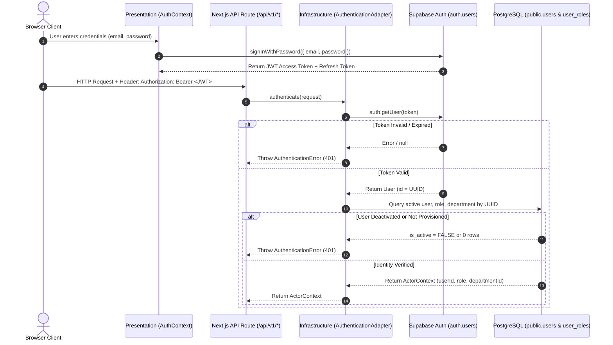

# Phase 09B — Authentication & Identity Architecture Assessment

**Classification:** Application Security & Cryptographic Identity  
**Target:** Supabase Authentication & PostgreSQL Role-Based Access Control (RBAC)  
**Components:** `src/infrastructure/auth/AuthenticationAdapter.ts`, `src/presentation/context/AuthContext.tsx`, `src/infrastructure/database/pool.ts`  

---

## 1. Authentication Lifecycle & Verification Pipeline



---

## 2. Technical Evaluation of Authentication Mechanisms

### 2.1 Identity Validation & Token Verification
In `src/infrastructure/auth/AuthenticationAdapter.ts` (lines 59–83):
- Incoming requests are inspected for `Authorization: Bearer <token>`.
- In production, unverified test bypasses (e.g. `x-actor-id`) are strictly rejected.
- The JWT is verified using `supabaseClient.auth.getUser(token)`. This ensures that the cryptographic signature, expiration timestamp, and revocation state are evaluated directly by the authoritative Supabase identity service.

### 2.2 Identity Mapping to `public.users`
In `AuthenticationAdapter.ts` (lines 89–108):
- The resolved `data.user.id` from Supabase Auth is strictly mapped to `public.users.id` via parameterized query:
  ```sql
  SELECT 
    u.id, 
    u.email, 
    u.full_name, 
    u.is_active,
    ur.role_id,
    dm.department_id
  FROM users u
  LEFT JOIN user_roles ur ON u.id = ur.user_id
  LEFT JOIN department_memberships dm ON u.id = dm.user_id AND dm.is_active = TRUE
  WHERE u.id = $1
  LIMIT 1;
  ```
- **Integrity Rule:** If an identity exists in `auth.users` but does not exist in `public.users`, authentication fails immediately with:
  `"Authenticated identity does not map to any active user record in institution directory."` (HTTP 401).

### 2.3 Inactive Account Enforcement
In `AuthenticationAdapter.ts` (lines 111–113):
- The `u.is_active` boolean column is checked.
- If `is_active === false`, an `AuthenticationError("User account is deactivated.")` is thrown immediately, revoking access even if the client holds a valid JWT token.

### 2.4 Department Scope Derivation
- Department memberships are derived exclusively from active rows in `department_memberships` (`dm.is_active = TRUE`).
- Handlers and Department Heads are strictly scoped to their assigned `department_id`. If reassigned or deactivated, permissions immediately reflect the database state.

---

## 3. Transaction-Scoped Identity Propagation (PostgreSQL RLS)

### 3.1 Architecture Review
When database queries execute within a pooled connection (especially via PgBouncer), setting session-wide variables (such as `SET app.current_user_id = '...'`) creates severe **connection contamination bugs**: another client borrowing the same connection from the pool would inherit the previous user's identity.

### 3.2 Evaluation of Campus Plus Implementation
In `src/infrastructure/database/pool.ts` (`executeTransaction()`, lines 174–189):
```typescript
await client.query("BEGIN;");
if (options?.actorId) {
  // Enforce transaction-local identity context for RLS evaluation
  await client.query("SELECT set_config('request.jwt.claim.sub', $1, true);", [options.actorId]);
  await client.query("SELECT set_config('app.current_user_id', $1, true);", [options.actorId]);
}
const txAdapter = new PostgresClientQueryAdapter(client);
const result = await callback(txAdapter);
await client.query("COMMIT;");
```

### 3.3 Security & Reliability Finding
- **`is_local = true` Parameter:** In `set_config(name, value, is_local)`, setting the third argument to `true` guarantees that the setting is **transaction-local**.
- Upon `COMMIT` or `ROLLBACK`, PostgreSQL automatically clears the configuration parameter.
- When `client.release()` returns the connection to the pool, zero identity state lingers on the socket.
- **Verification:** Unit test `tests/database/connection-safety.test.ts` explicitly asserts that identity context does not leak between transactions or after rollbacks.

---

## 4. Architecture Decision Record (ADR-009B-1)

### Title: Transaction-Local Claims Propagation for Serverless Database Pooling

- **Status:** Ratified & Active
- **Context:**
  Campus Plus operates on Vercel Serverless connected to Supabase PostgreSQL via PgBouncer in Transaction Pooling mode. Row-Level Security (RLS) policies in `migrations/00008_row_level_security_policies.sql` rely on `auth.uid()` or `current_setting('app.current_user_id', true)` to enforce row isolation.
- **Decision:**
  1. All database operations requiring actor identity context MUST execute inside `executeTransaction(callback, { actorId })`.
  2. The database adapter MUST invoke `SELECT set_config(..., true)` strictly inside an active transaction block.
  3. Session-level configuration commands (`SET SESSION ...` or `set_config(..., false)`) are strictly forbidden.
- **Consequences:**
  - Connection multiplexing in PgBouncer is safe from cross-tenant context bleeding.
  - RLS policies receive verified identity claims without requiring direct Supabase client RPC wrapping.
  - Offline integration testing using embedded PGlite functions identically to live PostgreSQL.
