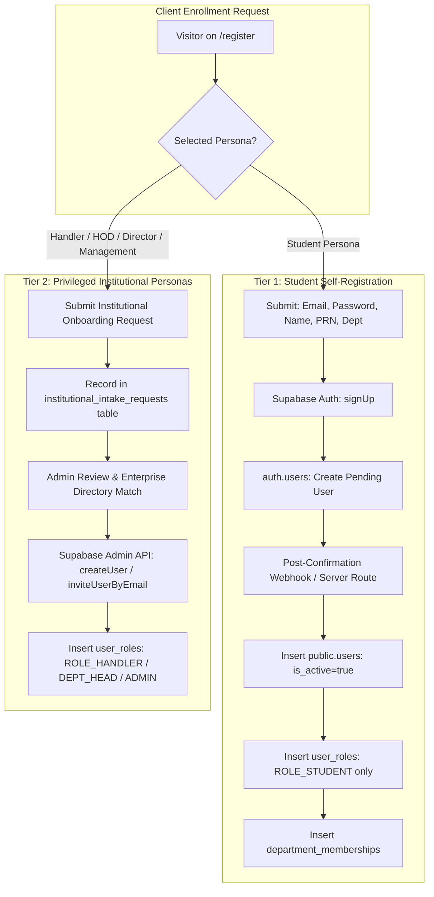

# Phase 09B — Real Institutional Registration Architecture & Specification

**Classification:** Enterprise Identity Architecture & Application Security  
**Target:** User Enrollment, Account Provisioning, and Role Governance  
**Status:** ARCHITECTURE DESIGN (Implementation scheduled for Phase 09C)  

---

## 1. Problem Statement & Current State

In `src/presentation/components/auth/RoleRegistrationForm.tsx`, the registration form performs a mock timeout simulation (`setTimeout`) that produces protocol tracking code `IAM-REG-PENDING`.
- **Limitation:** No record is created in Supabase Auth (`auth.users`) or PostgreSQL (`public.users`).
- **Objective:** Design a production-grade, two-tier onboarding pipeline where:
  1. Students can self-register using authentic email verification and secure server-side role assignment.
  2. Privileged institutional roles (Handlers, HODs, Directors, Management) are strictly guarded against unverified self-escalation.

---

## 2. Real Registration Architecture: Two-Tier Separation



---

## 3. Tier 1: Student Self-Registration Workflow

### 3.1 Step-by-Step Flow
1. **Client Submission:**
   Student fills out `fullName`, `email` (must be institutional domain if enforced, or valid email), `password`, `roll_or_prn`, and `department_id`.
2. **Supabase Auth Account Creation:**
   The frontend calls:
   ```typescript
   const { data, error } = await supabase.auth.signUp({
     email,
     password,
     options: {
       data: {
         full_name: fullName,
         roll_or_prn: rollOrPrn,
         department_id: departmentId,
       },
     },
   });
   ```
3. **Database Profile Synchronization:**
   Upon successful signup (or upon email confirmation), an authoritative server-side endpoint (`POST /api/v1/auth/provision-student`) or PostgreSQL trigger on `auth.users` creates the profile:
   ```sql
   INSERT INTO public.users (id, email, full_name, roll_or_prn, is_active)
   VALUES (NEW.id, NEW.email, NEW.raw_user_meta_data->>'full_name', NEW.raw_user_meta_data->>'roll_or_prn', TRUE);

   INSERT INTO public.user_roles (user_id, role_id)
   VALUES (NEW.id, 'ROLE_STUDENT');
   ```
4. **Strict Security Invariant:**
   **Client input can NEVER dictate technical role.** The role is hardcoded to `'ROLE_STUDENT'` in the server provisioning logic. Any role parameters sent from the client are discarded.

---

## 4. Conflict Resolution & Error Taxonomy

### 4.1 Duplicate Handling
1. **Duplicate Email:**
   If `email` already exists in `auth.users` or `public.users`:
   - Supabase Auth returns a clear error or triggers security obfuscation depending on project configuration.
   - The UI displays an `AlertBanner` with `variant="error"`:
     *"An account with this institutional email already exists. Please sign in or reset your password."*
2. **Duplicate Roll / PRN:**
   `public.users.roll_or_prn` has a unique constraint. If a student attempts to enroll with an already registered PRN:
   - The server rejects the enrollment with HTTP `409 Conflict` (`CONFLICT_PRN_EXISTS`).
   - The UI directs the student to campus identity administration.

### 4.2 Credential & Secret Storage
- **Zero Secrets in Application Tables:** `public.users` contains zero password hashes, salt columns, or secret tokens. Passwords reside exclusively within Supabase Auth's managed, bcrypt-hashed `auth.users` infrastructure.

---

## 5. Tier 2: Privileged Institutional Personas (Handlers, HODs, Executives)

### 5.1 Prohibition of Public Self-Escalation
Self-registration for `ROLE_HANDLER`, `ROLE_DEPT_HEAD`, `ROLE_ADMIN`, and `ROLE_MANAGEMENT` from a public internet form is a **critical vulnerability**.
Under no circumstances may a user create an account with triage, assignment, or resolution authority without institutional verification.

### 5.2 Controlled Onboarding Procedure
1. **Intake Logging:**
   Faculty/Staff submitting an onboarding request on `/register` have their request recorded in a dedicated table `institutional_onboarding_requests`.
2. **Verification & Provisioning:**
   The System Administrator verifies the employee's institutional credentials against the faculty roster, then provisions the account via `scripts/provision-staging-accounts.js` or administrative dashboard.
3. **Activation:**
   The employee receives an official verification email with an activation link and signs in under their designated technical persona.
