# Phase 09B — Remediation Roadmap & Execution Sequencing

**Classification:** Engineering Roadmap & Change Management  
**Prerequisite:** Phase 09B Audit Verification (Complete)  
**Target Execution:** Phase 09C (Implementation) & Phase 09D (Staging Deployment Verification)  

---

## 1. Operating Rules & Phased Separation

- **Phase 09B (Current):** Architectural Investigation, Forensic Verification, and Planning. **Zero modifications to application code, production environment variables, or live databases.**
- **Phase 09C (Next Phase):** Code-Level Remediation, Unit/Integration Test Suite Expansion, and Local Verification.
- **Phase 09D:** Administrative Staging Account Provisioning, Vercel Environment Configuration, Staging Preview Verification, and Production Deployment.

---

## 2. Exact Remediation Sequence

```mermaid
flowchart TD
    subgraph Step1 [Step 1: API Fast-Fail & Route Decoupling]
        A1[Update AuthenticationAdapter: Add pre-flight token checker]
        A2[Update /api/v1/*/route.ts: Call pre-flight token checker before getContainer]
        A3[Verify unauthenticated requests return 401 in <5ms without touching DB]
    end

    subgraph Step2 [Step 2: Database Pool & Env Resilience]
        B1[Update pool.ts: Increase timeout to 10000ms, set max: 2 for serverless]
        B2[Update env.ts: Enforce strict production rules when NODE_ENV=production]
        B3[Verify fail-fast protections and connection pooling tests]
    end

    subgraph Step3 [Step 3: Frontend Navigation & Accessibility]
        C1[LandingHeader.tsx: Replace #help with /help, add #transparency target]
        C2[LandingHeader.tsx: Add auto-close on link click in mobile drawer]
        C3[LandingFooter.tsx: Add links to /help, /privacy, /terms; dynamic copyright]
        C4[PasswordField.tsx: Remove tabIndex=-1, add aria-label and aria-pressed]
    end

    subgraph Step4 [Step 4: Real Registration Pipeline]
        D1[Implement POST /api/v1/auth/register-student with Supabase Auth]
        D2[Enforce server-side ROLE_STUDENT assignment]
        D3[Update RoleRegistrationForm.tsx to invoke real registration endpoint]
    end

    subgraph Step5 [Step 5: Staging Provisioning & Evaluator Sandbox]
        E1[Execute provision-staging-accounts.js with verified service role key]
        E2[Add sandbox helper on /login for one-click evaluator persona inspection]
    end

    Step1 --> Step2 --> Step3 --> Step4 --> Step5
```

---

## 3. Files Impacted & Exact Planned Changes

| Target File | Component | Nature of Planned Change |
| :--- | :--- | :--- |
| `src/infrastructure/auth/AuthenticationAdapter.ts` | Backend Auth | Add `validateAuthHeader(request: Request)` that verifies token presence and throws `AuthenticationError` before DB initialization. |
| `src/app/api/v1/auth/me/route.ts` | API Route | Call `AuthenticationAdapter.validateAuthHeader(request)` before `await getContainer()`. |
| `src/app/api/v1/complaints/route.ts` | API Route | Call `AuthenticationAdapter.validateAuthHeader(request)` before `await getContainer()`. |
| `src/infrastructure/database/pool.ts` | Database Pool | Increase `connectionTimeoutMillis` to `10000`, configure serverless pool options (`max: 2`, `idleTimeoutMillis: 15000`). |
| `src/config/env.ts` | Config Schema | Strengthen `isStrictProduction` check so `NODE_ENV === "production"` alone triggers mandatory production rules. |
| `src/presentation/components/landing/LandingHeader.tsx` | UI Header | Change `href="#help"` to `href="/help"`. Add `id="transparency"`. Add `onClick={() => setIsMobileOpen(false)}` to mobile drawer items. |
| `src/presentation/components/landing/LandingFooter.tsx` | UI Footer | Add navigational links to `/help`, `/privacy`, `/terms`. Compute dynamic copyright year `{new Date().getFullYear()}`. |
| `src/presentation/components/auth/PasswordField.tsx` | Accessibility | Remove `tabIndex={-1}`. Add `aria-label` and `aria-pressed`. |
| `src/presentation/components/auth/RoleRegistrationForm.tsx` | Auth UI | Replace `setTimeout` simulation with real call to `supabase.auth.signUp()` and profile synchronization. |
| `src/presentation/components/auth/SignInForm.tsx` | Auth UI | Surface evaluator sandbox credentials banner for the 5 demonstration personas. |

---

## 4. Rollback & Safety Gates

1. **Zero Database DDL:** All code changes are purely application-layer and additive. Zero migrations altering schema or dropping columns are permitted.
2. **Local Test Gate Before Any Git Push:**
   `pnpm verify` (Runs `tsc --noEmit`, `eslint`, `vitest run`, and `next build`).
3. **Staging Preview Verification:**
   Deploy to Vercel preview branch first; execute automated synthetic smoke tests before promoting to production.
