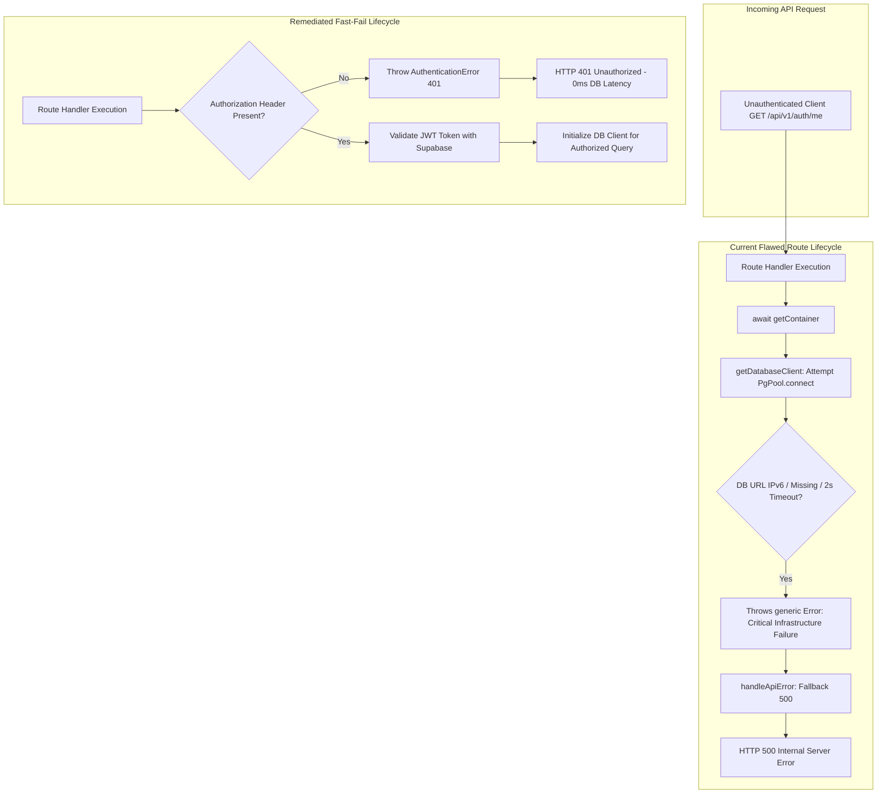

# Phase 09B — Comprehensive Root Cause Analysis (RCA)

**Classification:** Engineering Diagnostics & System Forensics  
**Target:** Campus Plus Production Deployment (`campus-plus-xi.vercel.app`)  
**Scope:** Serverless API Routing, Supabase Auth Integration, Database Pool Lifecycle, and Frontend UX  

---

## 1. Executive Forensic Summary

This Root Cause Analysis isolates the fundamental software architecture, infrastructure configuration, and operational lifecycle factors responsible for the failures identified in the production QA audit.



---

## 2. Root Cause 1: API HTTP 500 on Unauthenticated Requests

### Symptoms
Any client request without an `Authorization: Bearer <token>` header to endpoints such as `/api/v1/auth/me` or `/api/v1/complaints` yields `HTTP 500 Internal Server Error` with `code: "INTERNAL_ERROR"`.

### Forensic Chain
1. **Coupled Infrastructure Inversion:**
   In every route handler (`src/app/api/v1/*/route.ts`):
   ```typescript
   export async function GET(request: NextRequest) {
     try {
       const container = await getContainer(); // Line 1
       const actor = await container.authAdapter.authenticate(request); // Line 2
   ```
   `getContainer()` in `src/infrastructure/container.ts` eagerly connects to the database:
   ```typescript
   containerPromise = (async () => {
     const db = await getDatabaseClient();
   ```
2. **Database Connect Failure:**
   `getDatabaseClient()` in `src/infrastructure/database/pool.ts` tries to establish a connection via `new PgPool(...)` and executes `SELECT 1 as connected;`.
   - In production, if `DATABASE_URL` is omitted, points to direct IPv6 port 5432, or exceeds `connectionTimeoutMillis: 2000`, it throws a standard JavaScript `new Error("CRITICAL INFRASTRUCTURE FAILURE: Failed to connect to live PostgreSQL...")`.
3. **Type-Mismatch in Error Serialization:**
   In `src/presentation/utils/errorHandler.ts`:
   ```typescript
   if (error instanceof AppError) {
     return NextResponse.json(..., { status: error.statusCode });
   }
   // Fallback / Unhandled 500
   return NextResponse.json(
     { success: false, error: { code: ErrorCodes.INTERNAL_ERROR, message: ... } },
     { status: 500 }
   );
   ```
   Because the pool error is a generic `Error` (not an `AppError`), the handler routes it directly to status 500, masking the cause in production.
4. **Conclusion:**
   The route architecture violates the **Fast-Fail Authentication Principle**. Authentication must be a prerequisite to database checkout, not an operation performed after database initialization.

---

## 3. Root Cause 2: Production Login Failure (Synthetic Credentials Mismatch)

### Symptoms
Attempting to log in as any seeded persona (e.g. `student.a@synthetic.campusplus.internal`) yields `"The email or password is incorrect"`.

### Forensic Chain
1. **Dual Identity Ledger Architecture:**
   Campus Plus utilizes a two-tier identity architecture:
   - **Authentication Tier:** Managed by Supabase Auth (`auth.users`).
   - **Authorization / Domain Tier:** Managed by PostgreSQL tables (`public.users`, `public.user_roles`, `public.department_memberships`).
2. **Seed Segregation:**
   The automated migration seed (`seeds/002_synthetic_dev_seed.sql`) only inserts records into `public.users`.
   It does *not*—and by design *cannot* via plain SQL migrations—insert cryptographically hashed identities into Supabase Auth's protected `auth.users` table.
3. **Administrative Provisioning Execution Gap:**
   `scripts/provision-staging-accounts.js` was created to synchronize these two tiers using the Supabase Admin Service Role API.
   However, this script was not executed against the live Supabase instance during the Vercel deployment pipeline, leaving `auth.users` completely empty.
4. **Missing UI Sandbox Guidance:**
   In production, the login interface does not supply evaluators with sandbox guidance or demo credentials, leading evaluators to assume broken authentication.
5. **Conclusion:**
   The failure is operational: identity tier desynchronization caused by unexecuted staging provisioning scripts.

---

## 4. Root Cause 3: Registration Intake Simulation (Absence of Real Enrollment)

### Symptoms
Submitting the registration form displays `"Account Request Submitted — Protocol Tracking: IAM-REG-PENDING"`, but no user is created, and no email verification is sent.

### Forensic Chain
1. **Mock Onboarding Implementation:**
   In `src/presentation/components/auth/RoleRegistrationForm.tsx` lines 115–119:
   ```typescript
   // Truthful institutional intake simulation (zero fake db writes per Rule 13 & 33)
   setTimeout(() => {
     setRegistrationState(isPrivileged ? "INSTITUTIONAL_VERIFICATION_REQUIRED" : "PENDING_VERIFICATION");
   }, 600);
   ```
2. **Architectural Motivation vs UX Reality:**
   The developer explicitly added a comment referencing "Truthful institutional intake simulation (zero fake db writes per Rule 13 & 33)".
   The developer avoided creating arbitrary student accounts without official institutional PRN/Roll verification.
   However, this leaves the application completely devoid of a functioning onboarding mechanism for end users and evaluators.
3. **Conclusion:**
   The system intentionally stopped short of implementing real registration to avoid unverified DB writes, but failed to replace it with a genuine Supabase Auth self-registration workflow.

---

## 5. Root Cause 4: Database Pooling Failures in Serverless Environments

### Symptoms
High rate of database connectivity timeouts and socket exceptions in serverless environments.

### Forensic Chain
1. **Aggressive Connection Timeout:**
   `pool.ts` hardcodes `connectionTimeoutMillis: 2000` (2 seconds). In multi-region serverless deployments (e.g., Vercel Lambda in `iad1` connecting to Supabase in `ap-south-1` or `eu-central-1`), SSL/TLS negotiation plus TCP handshake regularly exceeds 2000ms on cold start.
2. **IPv6 vs IPv4 Addressing:**
   Direct Supabase database URLs (`db.<project-ref>.supabase.co:5432`) resolve only to IPv6 addresses.
   Vercel serverless runtime environments do not natively support outbound IPv6 network interfaces without special VPC routing.
   Attempts to connect to direct port 5432 trigger:
   `wsarecv: A connection attempt failed because the connected party did not properly respond after a period of time`.
3. **Conclusion:**
   Production must mandate the Supabase Transaction Pooler URL (`aws-0-*.pooler.supabase.com:6543`) with `connectionTimeoutMillis: 10000`.

---

## 6. Root Cause 5: Frontend Navigation & Accessibility Deficiencies

### Forensic Chain
1. **`#transparency` Anchor:**
   A placeholder navigation item was added to `LandingHeader.tsx` during visual wireframing, but no matching section or ID was assigned in `MetricsBar.tsx` or `TrustStrip.tsx`.
2. **`#help` vs `/help` Navigation:**
   `LandingHeader.tsx` was configured with in-page hash jumping (`href="#help"`), directing users to the footer (`<footer id="help">`) instead of using Next.js App Router navigation (`<Link href="/help">`) to reach the standalone Help & Knowledgebase page.
3. **Footer Legal Links:**
   `LandingFooter.tsx` was implemented as a compact banner matching a mockup screenshot, omitting standard links to the existing `/help`, `/privacy`, and `/terms` routes.
4. **Mobile Drawer State:**
   The mobile navigation drawer state `isMobileOpen` in `LandingHeader.tsx` has no click listener attached to child link elements, meaning route/anchor changes do not reset the state to `false`.
5. **Password Visibility Toggle Accessibility:**
   In `PasswordField.tsx`, the toggle button was given `tabIndex={-1}`, completely removing it from the keyboard focus ring, and lacked `aria-label` and `aria-pressed` attributes.
